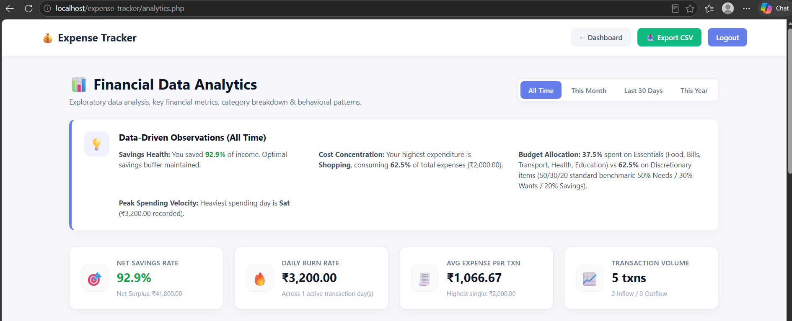
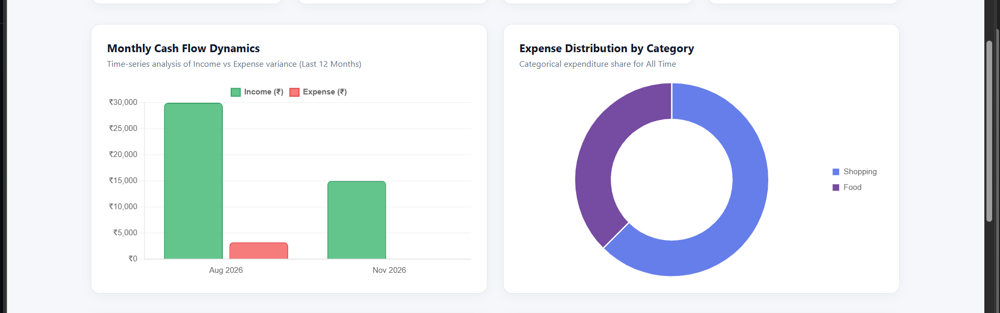
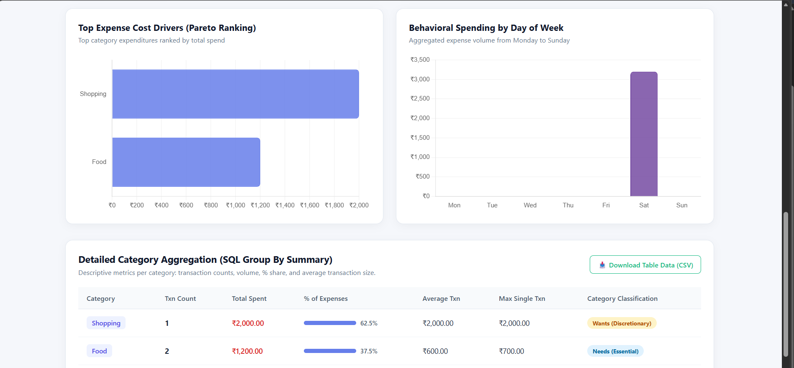

# Personal Expense Tracker

A full-stack personal finance management web application built with **PHP, MySQL, HTML, CSS, and JavaScript**. It helps users manage income and expenses, review transactions, monitor their financial position, and explore spending patterns through a dedicated analytics dashboard.

## Features

### Authentication
- User registration, login, and logout
- Password hashing
- Session-based authentication
- User-specific transaction access

### Financial Management
- Add, edit, and delete income and expense transactions
- Automatic balance calculation
- Monthly income and expense summaries

### Transaction Management
- Search transactions
- Filter by category and transaction type
- View recent transactions and transaction counts

### Financial Analytics
- Date filters: All Time, This Month, Last 30 Days, and This Year
- Data-driven observations, including savings health, cost concentration, budget allocation, and peak spending day
- Key metrics such as net savings rate, daily burn rate, average expense per transaction, and transaction volume
- Monthly income-versus-expense cash-flow chart
- Expense distribution by category
- Top expense categories ranked by spending (Pareto-style ranking)
- Spending patterns by day of the week
- Detailed category summary with transaction count, total spent, percentage share, average transaction, and maximum single transaction
- Export analytics and category data to CSV

## Screenshots

### Login


### Registration


### Dashboard


### Add Expense


### Add Income


### Dashboard and Transaction Management


### Financial Analytics
=======
###  Analytics





---


**Analytics overview — insights and key financial metrics**


**Cash flow and category distribution**


**Expense rankings, weekday spending, and category aggregation**


> The analytics screenshots above are included in this repository update under `screenshots/`. Add the other screenshot files listed earlier if you want those sections to display images as well.

## Technologies Used

| Technology | Purpose |
|---|---|
| PHP | Backend development |
| MySQL | Database management |
| HTML5 | Page structure |
| CSS3 | Styling and responsive UI |
| JavaScript | Client-side interactions |
| XAMPP | Local development environment |

## Project Structure

```text
expense_tracker/
│
├── index.php
├── register.php
├── dashboard.php
├── add_transaction.php
├── edit_transaction.php
├── delete_transaction.php
├── logout.php
│
├── analytics.php
├── config/
│   └── db.php
├── css/
│   └── style.css
├── js/
│   └── script.js
├── database/
│   └── expense_tracker.sql
├── screenshots/
│   ├── login.png
│   ├── register.png
│   ├── dashboard.png
│   ├── add-expense.png
│   ├── add-income.png
│   ├── dashboard-ext.png
│   ├── analytics-overview.png
│   ├── analytics-charts.png
│   └── analytics-breakdown.png
├── .gitignore
└── README.md
```

*The structure above reflects the files and folders described for the project. Keep the entries only if they match the actual repository contents.*

## Database

The application uses MySQL with two main tables:

### Users
Stores registered user information.

### Transactions
Stores transaction details, including:
- User ID
- Transaction type (income or expense)
- Category
- Amount
- Description
- Transaction date

Each transaction is associated with a user through `user_id`.

## Security

- Passwords are hashed using PHP `password_hash()`.
- Passwords are checked using `password_verify()`.
- Prepared SQL statements are used to help prevent SQL injection.
- Session-based authentication protects signed-in pages.
- Transaction edit and delete operations check ownership so users can access only their own records.

## Installation

### 1. Install XAMPP
Install XAMPP and start **Apache** and **MySQL**.

### 2. Place the project in `htdocs`
Clone or copy the project into:

```text
C:\xampp\htdocs\expense_tracker\
```

### 3. Create and import the database
1. Open `http://localhost/phpmyadmin`.
2. Create a database named `expense_tracker`.
3. Import `database/expense_tracker.sql`.

### 4. Configure the database connection
Open `config/db.php` and verify that the host, database name, username, and password match your local MySQL configuration.

### 5. Run the application
Open:

```text
http://localhost/expense_tracker/
```

## Application Flow

```text
User
 │
 ▼
Registration / Login
 │
 ▼
Dashboard
 ├── Add Income
 ├── Add Expense
 ├── Edit Transaction
 ├── Delete Transaction
 ├── Search and Filter
 └── Financial Analytics
      ├── Key Financial Metrics
      ├── Cash Flow Analysis
      ├── Category Distribution
      ├── Spending Pattern Analysis
      └── CSV Export
```

## Future Improvements

Potential enhancements include:
- Budget planning and budget alerts
- Recurring transactions
- PDF export
- Dark mode
- Email notifications
- Multi-currency support

## Author

**Desh Changappa**  
BCA Student

## Project Purpose

This project was developed as a portfolio project to demonstrate practical skills in:
- Full-stack web development
- PHP backend development
- MySQL database management
- CRUD operations and authentication
- Responsive UI development
- JavaScript interactions
- Financial data analysis and visualisation
