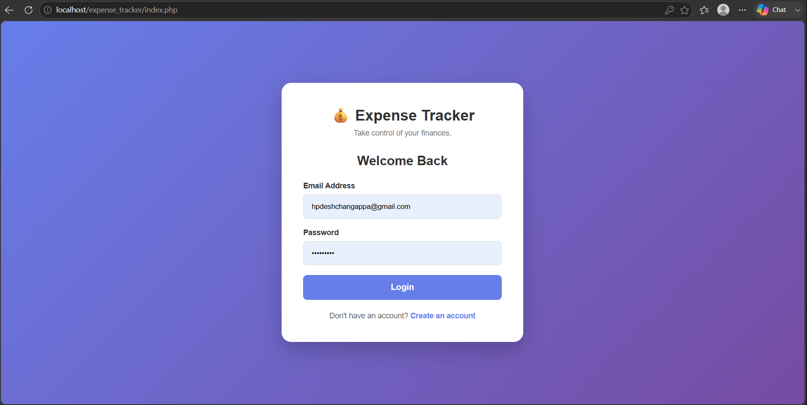
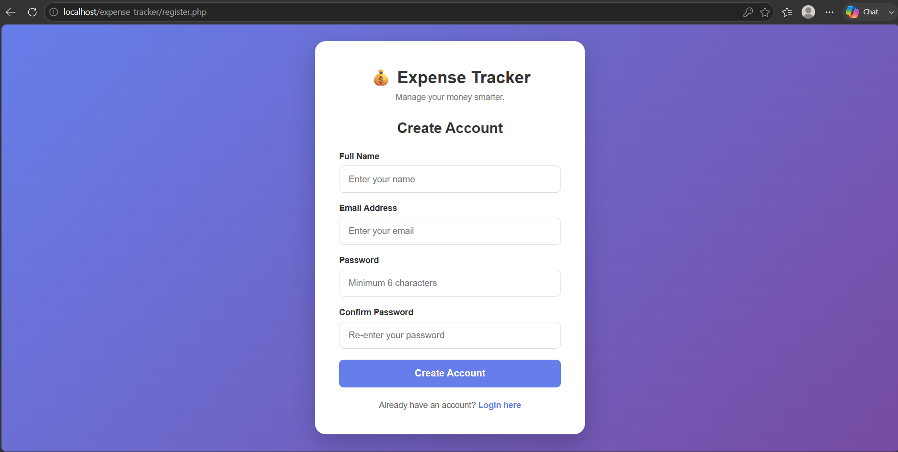
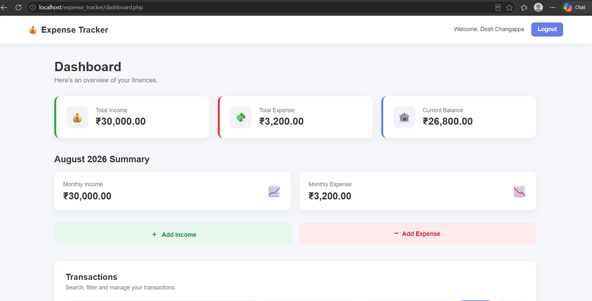
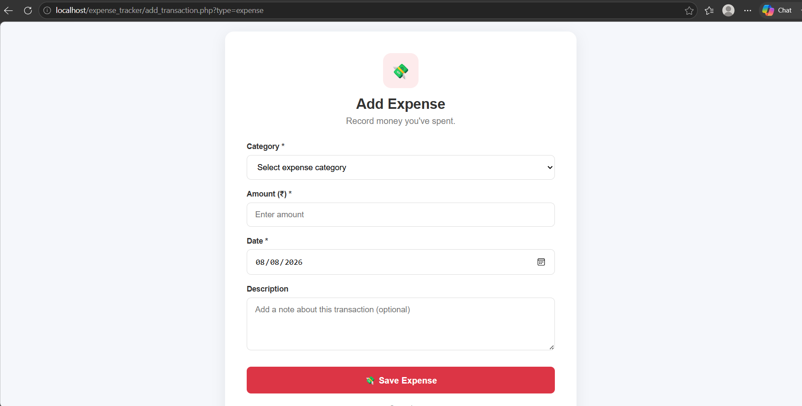
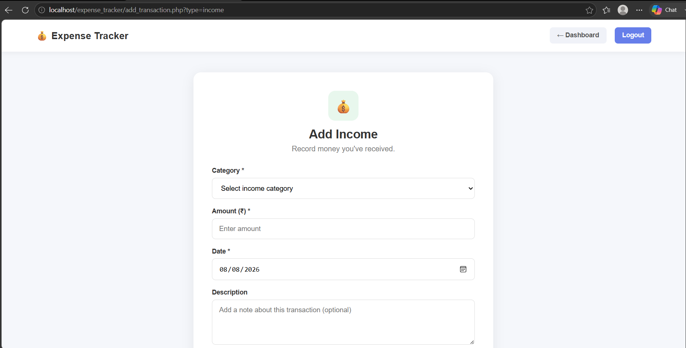
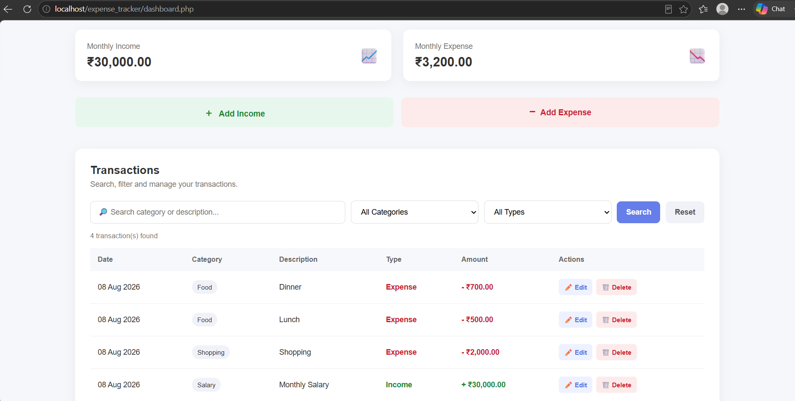

# 💰 Personal Expense Tracker

A full-stack personal finance management web application built using PHP, MySQL, HTML, CSS and JavaScript.

The application allows users to securely manage their income and expenses, monitor their financial balance, and search and filter transactions through an intuitive dashboard.

---

## 🚀 Features

### 🔐 Authentication

- User registration
- User login and logout
- Secure password hashing
- Session-based authentication

### 💰 Financial Management

- Add income
- Add expenses
- Edit transactions
- Delete transactions
- Automatic balance calculation
- Monthly income summary
- Monthly expense summary

### 🔎 Transaction Management

- Search transactions
- Filter by category
- Filter by transaction type
- View recent transactions
- Transaction result count

### 🎨 User Interface

- Modern dashboard
- Responsive design
- Mobile-friendly layout
- Clean transaction table
- User-friendly forms
- Visual income and expense indicators

---

---

## 📸 Screenshots

### 🔐 Login



### 📝 Registration



### 📊 Dashboard



### 💸 Add Expense



### 💰 Add Income



### 🔎 Dashboard & Transaction Management



---

## 🛠️ Technologies Used

| Technology | Purpose |
|------------|---------|
| PHP | Backend development |
| MySQL | Database management |
| HTML5 | Page structure |
| CSS3 | Styling and responsive UI |
| JavaScript | Client-side interactions |
| XAMPP | Local development environment |

---

## 📂 Project Structure

```text
expense_tracker/
│
├── index.php
├── register.php
├── dashboard.php
├── add_transaction.php
├── edit_transaction.php
├── delete_transaction.php
├── logout.php
│
├── config/
│   └── db.php
│
├── css/
│   └── style.css
│
├── js/
│   └── script.js
│
├── database/
│   └── expense_tracker.sql
│
├── .gitignore
└── README.md

---
###🗄️ Database
---

The application uses MySQL with two main tables:

Users

Stores registered user information.

Transactions

Stores:

Income
Expenses
Categories
Amounts
Descriptions
Transaction dates

Each transaction is associated with a specific user using user_id.

###🔐 Security Features
Passwords are securely hashed using PHP password_hash().
Password verification uses password_verify().
Prepared SQL statements are used to reduce SQL injection risks.
Session-based authentication.
Users can only access their own transactions.
Edit and delete operations verify transaction ownership.

###⚙️ Installation
1. Install XAMPP

Install XAMPP and start:

Apache
MySQL
2. Clone or copy the project

Place the project inside:

xampp/htdocs/

The final path should be:

xampp/htdocs/expense_tracker/
3. Create the database

Open:

http://localhost/phpmyadmin

Create a database named:

expense_tracker

Import:

database/expense_tracker.sql
4. Configure the database

Open:

config/db.php

Make sure the database settings match your XAMPP configuration.

5. Run the application

Open:

http://localhost/expense_tracker/
📊 Application Flow
User
 │
 ▼
Registration
 │
 ▼
Login
 │
 ▼
Dashboard
 │
 ├── Add Income
 │
 ├── Add Expense
 │
 ├── Edit Transaction
 │
 ├── Delete Transaction
 │
 ├── Search
 │
 └── Filter
 │
 ▼
Financial Summary

📈 Future Improvements

Possible future enhancements include:

Expense charts and visual analytics
Budget planning
Export transactions to CSV/PDF
Recurring transactions
Dark mode
Email notifications
Advanced financial reports
Multi-currency support

----------------------------------------------------------------------------------------
👩‍💻 Author

Desh Changappa

BCA Student

⭐ Project Purpose

This project was developed as a portfolio project to demonstrate practical skills in:

Full-stack web development
PHP backend development
MySQL database management
CRUD operations
Authentication
Responsive UI design
JavaScript
Database-driven application development

---

